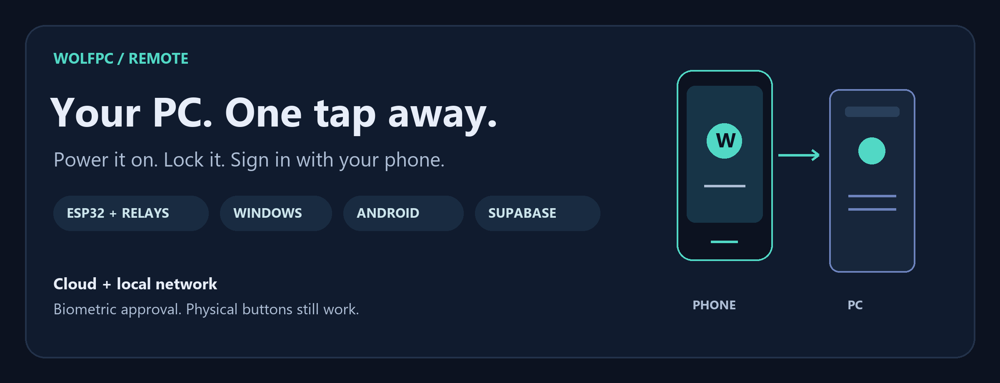
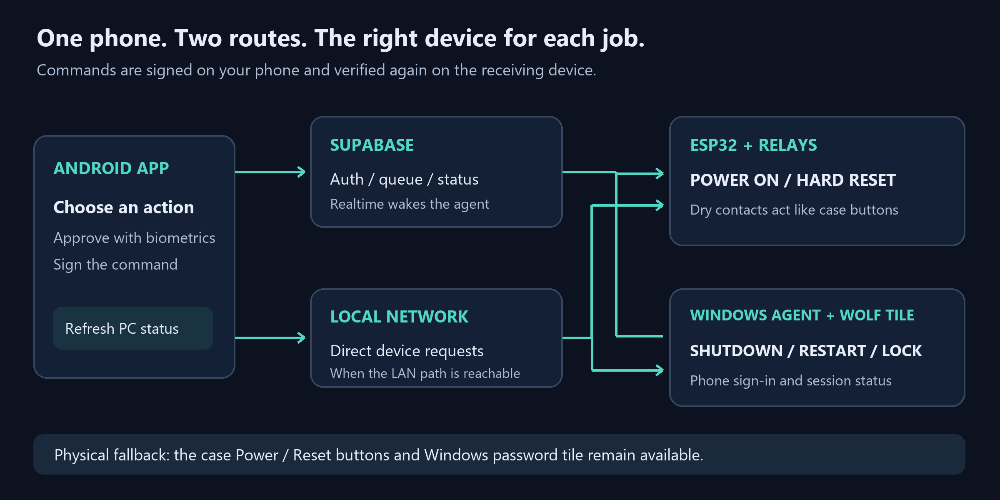
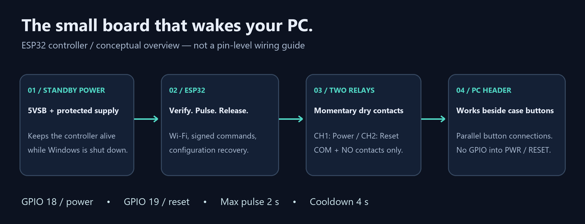

# WolfPC Remote

**Turn on your PC, manage Windows, and approve sign-in from your Android phone.**

[Get started](#build-your-own) · [Hardware guide](docs/HARDWARE.md) · [Security](docs/SECURITY.md) · [Latest changes](docs/UPDATES-1.1.md)

**ESP32 + relays** · **Windows 11** · **Android** · **Supabase**

## Why WolfPC?

Sometimes you need your PC before you can get to its power button. WolfPC gives
you a way to wake it from your phone, check what Windows is doing, and approve
sign-in with a fingerprint. When you're finished, you can lock it or shut it down
from the same app.

A small ESP32 inside the case handles the physical buttons. A Windows service
handles the operating system. Your phone brings them together, with Supabase
connecting the pieces when you're away from home.

This is a DIY project for **one owner and one Windows PC**. The case buttons
remain connected, and the Windows password tile remains available.

## What you can do

| From your phone | What happens on the PC |
| --- | --- |
| **Power on** | The ESP32 briefly closes the power-button relay. |
| **Shutdown** | The Windows agent requests shutdown with a five-second countdown after delivery. Save your work first. |
| **Restart** | The agent requests a Windows restart. |
| **Hard reset** | The ESP32 pulses the reset-button relay. Use this only when you need a hardware reset. |
| **Lock PC** | Windows locks the current session, like pressing Win+L. |
| **Phone sign-in / unlock** | With enrollment and the Wolf tile installed, your biometric approval authorizes the agent to release a locally sealed Windows credential. |
| **Refresh** | Read the latest status without leaving the home screen. |

You also get QR pairing, command history, controller and agent availability,
and notifications for events the running app observes. There is **no Firebase
dependency** and no push delivery while Android has stopped the app.

## How the pieces fit

The app tries the local route before falling back to the cloud. Both routes
carry the same signed command; the receiving device verifies it before acting.
Windows commands can wake the agent through Supabase Realtime, with polling
remaining available as a fallback. The ESP32 polls for its cloud commands.

The controller needs **standby power** to turn on a PC that has been shut down.
If the PSU is switched off or unplugged, remote power-on cannot work.

## Build your own

Start with the [deployment guide](docs/DEPLOY.md) for the full setup sequence.
The component READMEs below describe the current builds and features; the
deployment guide also contains notes from earlier versions.

1. **Set up Supabase.** Create the owner account, apply the migrations, deploy
   the functions, and provision the two device identities.
2. **Test the ESP32 on the bench.** Build the firmware and verify relay behavior
   before connecting anything to the motherboard.
3. **Wire and mount the controller.** Keep the case buttons connected in
   parallel and use a protected standby supply. Follow the hardware guide.
4. **Install the Windows agent.** Check its status, then generate a pairing QR.
5. **Build the Android app and pair.** Scan the QR, sign in, and pair your phone.
6. **Add phone unlock if you want it.** Enroll your Windows password locally,
   test the approval flow, then install the credential provider.

### Pick the part you're working on

| Component | What it owns | Start here |
| --- | --- | --- |
| ESP32 firmware | Power/reset relays, Wi-Fi, LAN API, configuration recovery | [Firmware README](firmware/README.md) |
| Windows agent | Session status, lock, shutdown, restart, login approval | [Agent README](agent/README.md) |
| Android app | Biometric signing, QR pairing, controls, history | [Android README](android/README.md) |
| Supabase | Auth, database, RLS, command queue, Edge Functions | [Backend README](supabase/README.md) |
| Credential provider | The Wolf tile on the Windows sign-in screen | [Credential provider README](credential-provider/README.md) |
| Tools | Provisioning, device rotation, protocol simulation | [Tools README](tools/README.md) |

## The reference build

The project was assembled with an ESP32-WROOM-32 dev board, a 5 V two-channel
relay module, a Gigabyte B450 AORUS M motherboard, and a Corsair CV450 PSU.
Windows runs the .NET 9 agent; the phone runs the Kotlin / Jetpack Compose app.

The illustration explains the roles. Use the [hardware runbook](docs/HARDWARE.md)
and your motherboard manual for the actual connections. Relay contacts go across
the button pins; ESP32 power and GPIO must not connect directly to those pins.

## Security, in plain language

- **A login token alone cannot press a button.** Commands also need a signature
  from the paired phone's Android Keystore key, authorized with biometrics.
- **The PC checks the signature too.** The ESP32 and agent independently verify
  commands, expiry, and replay protection.
- **Windows credentials stay on the PC.** Phone unlock uses a DPAPI-sealed local
  password. It is not a passwordless Windows authentication package, and a local
  administrator is outside that protection boundary.
- **The local routes have different protections.** The agent uses pinned HTTPS;
  the controller uses HTTP on the private LAN with signed commands.
- **Provisioning secrets stay local.** Real `.env` files, firmware credentials,
  signing keystores, and `Key.txt` are excluded from Git. Examples use placeholders.

Read the [security model](docs/SECURITY.md) before deploying your own build.

## A few practical limits

An offline agent does not prove the PC is powered off. Motherboard power sensing
has not been added yet. Notifications depend on the app observing updates, and
cloud delivery depends on connectivity. A shutdown countdown starts after the
request reaches Windows; it is not a promise that the PC will power off in five
seconds.

Firmware configuration recovery helps with partial settings loss. It cannot
recover erased flash or failed hardware. Keep your provisioning configuration
current, especially after rotating a device secret.

## Explore further

| Guide | Read it when you want to… |
| --- | --- |
| [Architecture](docs/ARCHITECTURE.md) | Understand which component makes each decision |
| [Protocol](docs/PROTOCOL.md) | Inspect envelopes, signatures, and device authentication |
| [Hardware](docs/HARDWARE.md) | Bench-test, wire, and power the controller |
| [Phone unlock](docs/PHASE8-LOGIN.md) | Understand enrollment and the Windows tile |
| [Notifications](docs/NOTIFICATIONS.md) | Understand which events the app can report |
| [Version 1.1 updates](docs/UPDATES-1.1.md) | Read about Refresh, Lock PC, and faster agent delivery |

Want a useful next improvement? Connection diagnostics and actual motherboard
power sensing are good places to start. Keep changes small, test the receiving
device as well as the app, and preserve the physical fallback.
